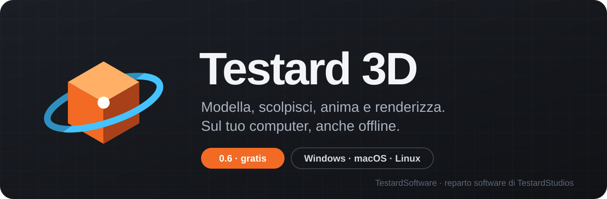
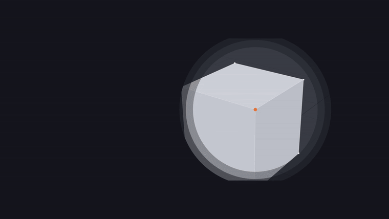
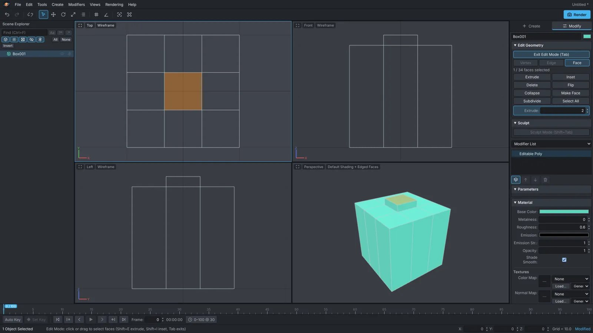
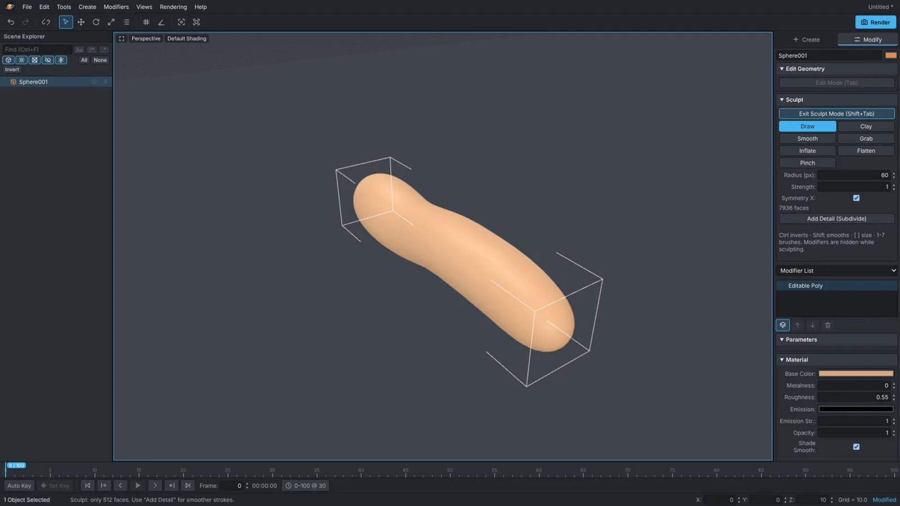
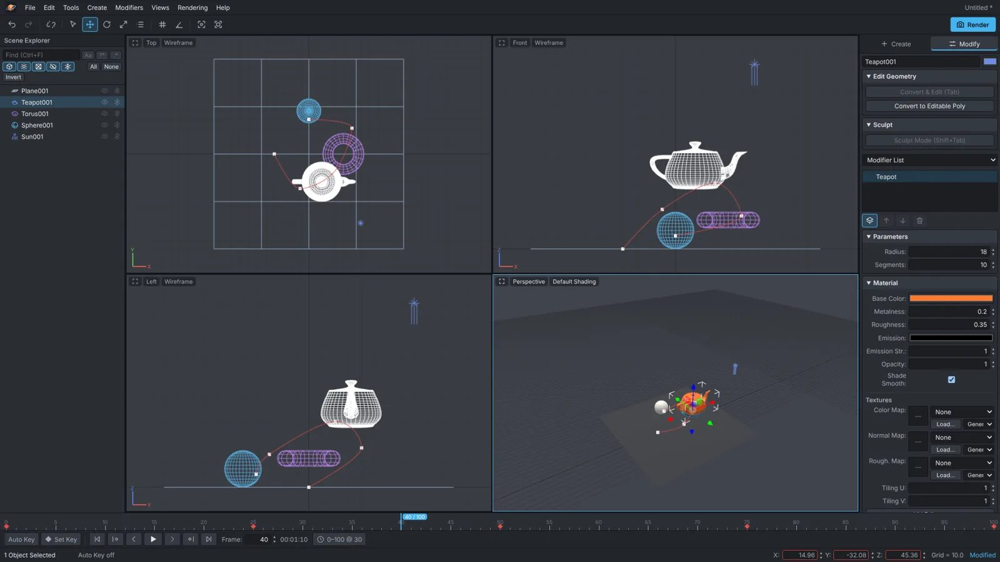
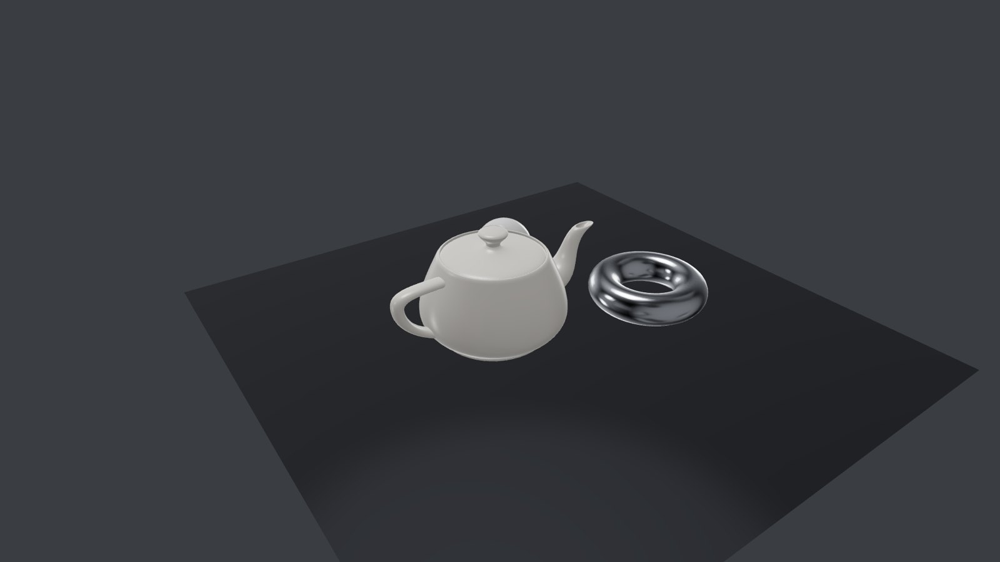
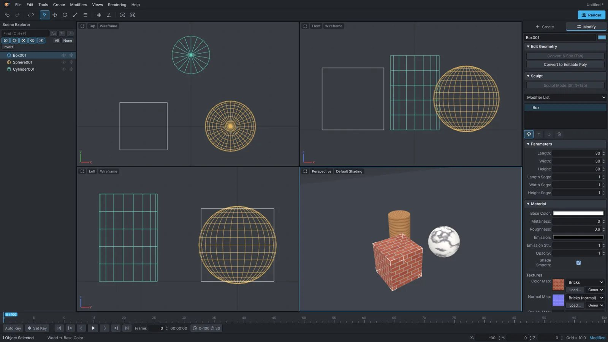
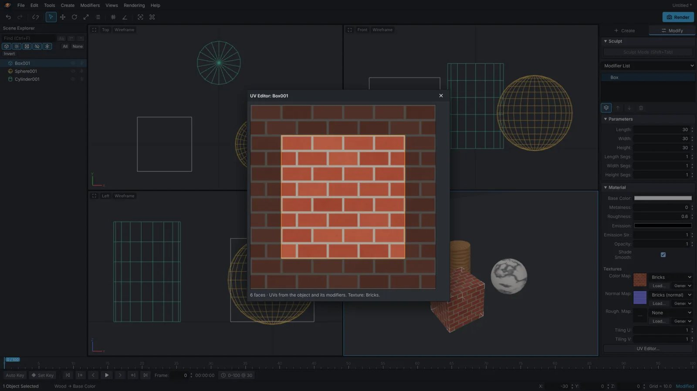

  

  <a href="#scarica"><b>Scarica la 0.6 gratis</b></a>
  &nbsp;·&nbsp;
  <a href="assets/trailer.mp4"><b>Guarda il trailer</b></a>
  &nbsp;·&nbsp;
  <a href="https://software.testardstudios.it/prodotti/testard-3d"><b>Sito</b></a>
  &nbsp;·&nbsp;
  <a href="https://software.testardstudios.it/prezzi"><b>Versioni nuove</b></a>

  

Testard 3D è un programma 3D desktop che si installa e funziona sul tuo computer, senza account e senza connessione. Ha quattro viewport, il Command Panel e lo stack dei modificatori come in 3ds Max, e l'Edit Mode con vertici, spigoli e facce come in Blender. Dentro trovi modellazione, scultura, UV e texture, animazione con keyframe e render.

Questa è la **versione 0.6, gratuita**. La puoi usare quanto vuoi, anche per lavoro. Le versioni nuove escono su [software.testardstudios.it](https://software.testardstudios.it) con un abbonamento da 2 € al mese, oppure 4 € al mese per tutta l'azienda.

---

## Scarica

| Sistema | File | Dimensione |
|---|---|---|
| **Windows** | [Testard3D-Setup-0.6.0.exe](https://github.com/federicolia-coder/Testard3D/releases/download/v0.6.0/Testard3D-Setup-0.6.0.exe): installer | 105 MB |
| **Windows** | [Testard3D-Portable-0.6.0.exe](https://github.com/federicolia-coder/Testard3D/releases/download/v0.6.0/Testard3D-Portable-0.6.0.exe): portabile, si avvia senza installare | 105 MB |
| **macOS** (Apple Silicon) | [Testard3D-0.6.0-arm64.dmg](https://github.com/federicolia-coder/Testard3D/releases/download/v0.6.0/Testard3D-0.6.0-arm64.dmg): M1, M2, M3, M4 | 123 MB |
| **macOS** (Intel) | [Testard3D-0.6.0-x64.dmg](https://github.com/federicolia-coder/Testard3D/releases/download/v0.6.0/Testard3D-0.6.0-x64.dmg) | 126 MB |
| **Linux** | [Testard3D-0.6.0.AppImage](https://github.com/federicolia-coder/Testard3D/releases/download/v0.6.0/Testard3D-0.6.0.AppImage): rendilo eseguibile e avvialo | 120 MB |

Tutti i file sono anche nella pagina [Release v0.6.0](https://github.com/federicolia-coder/Testard3D/releases/tag/v0.6.0), insieme ai checksum SHA-256.

### Primo avvio

Gli eseguibili non sono ancora firmati digitalmente, quindi il sistema chiede una conferma la prima volta:

- **Windows:** se compare "Windows ha protetto il PC", clicca *Ulteriori informazioni* e poi *Esegui comunque*.
- **macOS:** clic destro sull'app, poi *Apri* e ancora *Apri*.
- **Linux:** `chmod +x Testard3D-0.6.0.AppImage && ./Testard3D-0.6.0.AppImage`

L'installer di Windows associa i file `.t3d`, che poi si aprono con un doppio clic.

---

## Cosa puoi fare

<table>
  <tr>
    <td width="50%"> <b>Modella ogni vertice.</b> Tab per entrare in Edit Mode, 1/2/3 per vertici, spigoli e facce, Extrude, Inset e Subdivide.</td>
    <td width="50%"> <b>Scolpisci a mano libera.</b> Sette pennelli, simmetria X e Add Detail per i dettagli fini.</td>
  </tr>
  <tr>
    <td width="50%"> <b>Anima con un tasto.</b> Auto Key (N), timeline con keyframe e traiettorie nei viewport.</td>
    <td width="50%"> <b>Renderizza.</b> F9 per un'immagine fino a 4096 px, oppure l'animazione in video WebM.</td>
  </tr>
  <tr>
    <td width="50%"> <b>Materiali e texture.</b> PBR con mappe colore, normal e rugosità, anche procedurali.</td>
    <td width="50%"> <b>UV Editor.</b> Le UV sopra la texture, conservate da modellazione e modificatori.</td>
  </tr>
</table>

### Modellazione
- **Edit Mode** su vertici, spigoli e facce, con gizmo per spostare, ruotare e scalare (W/E/R) e Shift+trascinamento per estrudere al volo.
- **Strumenti:** Extrude (Shift+E), Inset (Shift+I), Delete, Flip, Collapse, Make Face (Shift+F), Subdivide (Catmull-Clark). Le misure di Extrude e Inset si correggono dopo, dal pannello *Last Operation*.
- **Modificatori non distruttivi:** Bend, Taper, Twist, Noise, Spherify, Subdivision Surface, Mirror, Array, Shell e Boolean (unione, sottrazione, intersezione). Si accendono, spengono e riordinano.
- **Primitive:** Box, Sphere, Cylinder, Cone, Torus, Plane, Teapot, Pyramid e l'helper Dummy.

### Scultura
- Sculpt Mode (Shift+Tab) con i pennelli **Draw, Clay, Smooth, Grab, Inflate, Flatten, Pinch** (tasti da 1 a 7).
- Ctrl inverte il pennello, Shift leviga al volo, [ e ] cambiano la dimensione. Ogni pennellata è un singolo undo.

### Materiali, luci, UV
- Materiali **PBR**: colore, metallicità, rugosità, emissione, opacità, Shade Smooth con auto-smooth.
- Luci **Omni, Spot e Sun** con ombre.
- Texture caricate (PNG, JPEG, WebP) o procedurali: scacchiera, griglia UV, mattoni, marmo, legno, nuvole, rumore. Vengono incorporate nel file `.t3d`.
- Modificatore **UVW Map** (planare, box, cilindrico, sferico) e **UV Editor**.

### Animazione
- **Auto Key** (N) e **Set Key** (K): ogni valore numerico si anima, dalle trasformazioni ai parametri di oggetti, modificatori e materiali.
- Interpolazione Smooth, Linear e Step. I keyframe si trascinano sulla timeline.
- Video **WebM** senza fotogrammi persi, ed **export GLB** con l'animazione.

### File
- Scene `.t3d` autonome, con le texture dentro.
- **Import** OBJ, glTF e GLB come mesh modificabili; **export** GLB (con materiali e animazione) e OBJ.

---

## Scorciatoie principali

| Tasto | Azione | Tasto | Azione |
|---|---|---|---|
| `Tab` | Edit Mode | `Shift+Tab` | Sculpt Mode |
| `1` `2` `3` | Vertici, spigoli, facce | `W` `E` `R` | Sposta, ruota, scala |
| `Shift+E` | Extrude | `Shift+I` | Inset |
| `Shift+F` | Make Face | `F9` | Render |
| `N` | Auto Key | `K` | Set Key |
| `/` | Play / Stop | `,` `.` | Fotogramma precedente / successivo |
| `Z` | Inquadra (Zoom Extents) | `Alt+W` | Ingrandisci il viewport |
| `H` | Select From Scene | `Ctrl+Z` `Ctrl+Y` | Undo / Redo |

L'elenco completo è nell'app, in *Help → Keyboard Shortcuts*.

---

## Gratis o abbonamento?

|  | **0.6 su GitHub** | **Ultima versione** su [software.testardstudios.it](https://software.testardstudios.it/prezzi) |
|---|---|---|
| Prezzo | Gratis | 2 € al mese per una persona, 4 € al mese per tutta l'azienda (non per utente) |
| Modellazione, scultura, UV, animazione, render | Sì | Sì |
| Selezione Loop e Ring, Loop Cut, Bevel, Weld | No | Sì, dalla 0.7 |
| Nuove funzioni man mano che escono | No | Sì |
| Uso commerciale | Sì | Sì |

Meglio 4 € al mese che 2.000 € l'anno.

---

## Unità e formati

- Il mondo è Z-up come in 3ds Max e un'unità vale un centimetro (la griglia è da 10).
- glTF/GLB vengono importati ed esportati in metri Y-up, con la conversione automatica.
- OBJ: gli assi vengono convertiti, la scala resta 1:1.

## Storia delle versioni

Le novità di ogni versione, dalla 0.1 alla 0.6, sono in [CHANGELOG.md](CHANGELOG.md).

## Licenza

La 0.6 è **gratuita**, anche per uso commerciale, ma non è open source: puoi usarla e condividere il link a questa pagina, non rivenderla né modificarla. Il testo completo, in italiano e in inglese, è in [LICENSE.md](LICENSE.md).

## Chi lo fa

Testard 3D è scritto da **TestardSoftware**, il reparto di programmazione di [TestardStudios](https://testardstudios.it), un collettivo di studenti nato a novembre 2025. Per domande, problemi o il piano per la tua azienda scrivici a [info@testardstudios.it](mailto:info@testardstudios.it) o dal [modulo contatti](https://software.testardstudios.it/contatti).

Testard 3D è un progetto indipendente, scritto da zero. Riprende il flusso di lavoro di 3ds Max e di Blender, ma non è affiliato né approvato da Autodesk o dalla Blender Foundation, e non contiene il loro codice. 3ds Max è un marchio di Autodesk, Inc.; Blender è un marchio della Blender Foundation.
